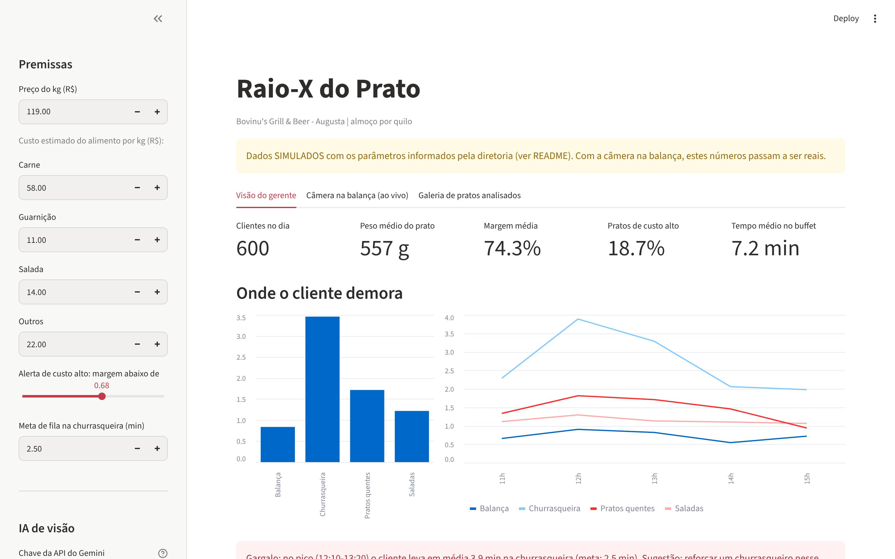
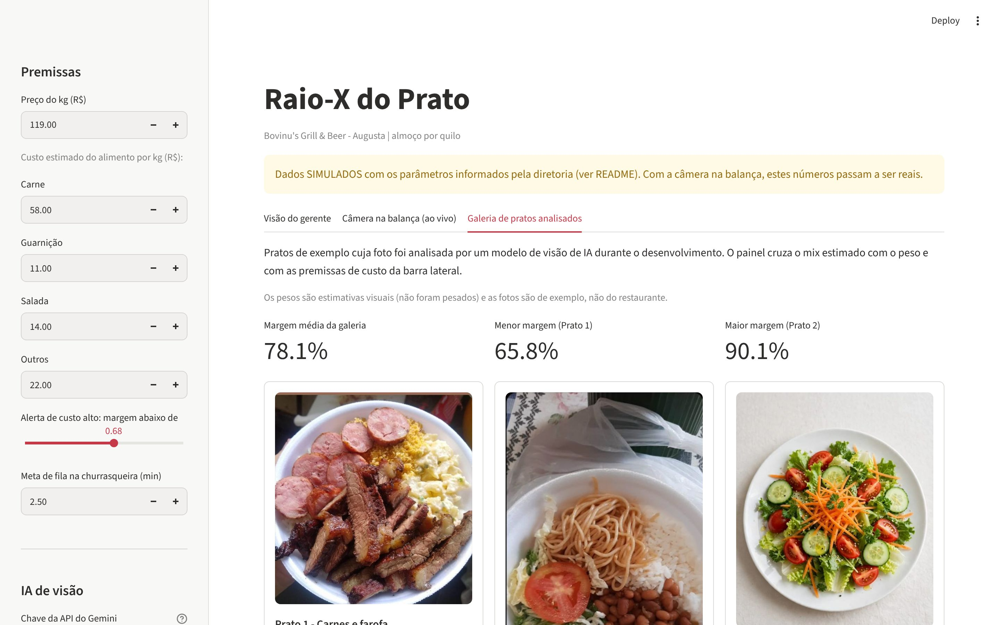

# Raio-X do Prato

**Uma câmera na balança que mostra ao gerente o que cada cliente serviu, quanto aquele prato rendeu e onde o cliente perdeu tempo no buffet.**

Protótipo do Hackathon FMU para o **Bovinu's Grill & Beer (Rua Augusta)**, almoço por quilo.

**Equipe:** Daniel Passiani, Pedro Torres e Kauan Lucindo | **Curso:** Análise e Desenvolvimento de Sistemas, FMU



## Resumo

| | |
|---|---|
| **Dor** | A casa só mede ticket e peso médio. Não sabe se 600 g na balança são de arroz ou de picanha, nem onde está a fila. |
| **Solução** | Câmera sobre a balança + IA de visão identifica o mix do prato; o painel cruza com o peso e o custo e mostra margem, alertas e gargalos. |
| **Custo** | Uma câmera na balança (sugestão da própria diretoria) + uso das câmeras Intelbras já instaladas. Não muda o fluxo do cliente. |
| **Resultado** | Primeira métrica de **mix e margem por prato** e de **tempo por estação**, com recomendações práticas ao gerente. |

## 1. O problema

A diretoria do Grupo Bovinu's apresentou o desafio: a casa atende cerca de 600 clientes por dia no almoço, mas hoje só mede **ticket médio e peso médio**. O restante é "olhômetro". Duas perguntas ficam sem resposta:

1. **O que o cliente pegou?** O peso é conhecido, mas não a composição. Pratos com muita carne custam muito mais para a casa pelo mesmo preço por quilo (foi apontada como a dor mais crítica).
2. **Onde o cliente demora?** A fila da churrasqueira já chegou a 4 min (a meta é 2,5 min), e o público executivo tem 30 a 40 min para almoçar.

Frase-guia do desafio: *"que dados o cliente demonstra, mas não conta?"* O prato na balança é exatamente isso: o cliente mostra o que escolheu, mas ninguém registra.

## 2. A solução

| Etapa | O que acontece |
|---|---|
| 1. Foto do prato | A câmera registra o prato no momento da pesagem (o cliente já para ali) |
| 2. IA de visão | Identifica os itens e estima a proporção de carne, guarnição, salada e outros |
| 3. Margem do prato | Cruza o mix com o peso e com o custo por categoria |
| 4. Tempo por estação | Mostra quanto tempo o cliente leva em saladas, quentes, churrasqueira e balança |
| 5. Painel do gerente | Margem por hora, gargalos e alertas com sugestão de ação |

**Respeita as restrições da diretoria:** não toca cozinha, compras, estoque nem pagamento; mantém o modelo por quilo; não adiciona catraca nem nada que afaste o contato humano com o cliente.

### As três telas do painel

- **Visão do gerente:** indicadores do dia, tempo por estação ao longo do almoço, alerta de gargalo (ex.: churrasqueira com 3,9 min no pico contra meta de 2,5 min, sugestão de reforço), mix médio e margem por hora.
- **Câmera na balança (ao vivo):** usa a câmera do computador ou do celular (ou uma foto enviada). A IA de visão identifica os itens do prato, e o painel calcula na hora o valor cobrado, o custo estimado e a margem. Cada prato analisado entra num registro da sessão.
- **Galeria de pratos analisados:** 9 pratos de exemplo com o mix estimado por IA de visão, mostrando como pratos de peso parecido rendem margens bem diferentes.



## 3. Como executar

```bash
pip install -r requirements.txt
streamlit run app.py
```

### Ligar a IA de visão (Gemini, chave gratuita)

1. Crie uma chave em [Google AI Studio](https://aistudio.google.com).
2. Cole a chave no campo **"Chave da API do Gemini"** na barra lateral do painel, ou defina a variável antes de rodar:

```bash
# Windows (PowerShell)
$env:GEMINI_API_KEY="sua-chave"
# Linux/Mac
export GEMINI_API_KEY="sua-chave"
```

3. Para conferir se a chave funciona: `python testar_ia.py`. Para reanalisar as fotos da galeria com a IA: `python testar_ia.py --galeria`.

A chave fica só na memória da sessão e **não deve ser enviada ao repositório**. Sem chave, a análise ao vivo funciona em modo simulado e avisa isso na tela. O código escolhe sozinho um modelo disponível para a chave (pode ser fixado com `RAIOX_MODELO_GEMINI`) e mostra mensagens claras em caso de chave inválida, limite de uso ou falta de conexão.

## 4. Estrutura

```
app.py          painel Streamlit (gerente, câmera ao vivo e galeria)
analisador.py   IA de visão (Gemini) e modo simulado
custos.py       premissas de preço/custo e cálculo de margem
simulador.py    gera um dia de almoço simulado
testar_ia.py    testa a chave e reanalisa a galeria
data/           pratos_simulados.csv, analises_fotos.json, fotos/ e fontes_imagens.md
docs/           capturas de tela
```

Para usar dados reais, salve um CSV com as mesmas colunas de `data/pratos_simulados.csv` em `data/pratos.csv`. O painel passa a usá-lo automaticamente.

## 5. Impacto (estimativa ilustrativa)

Na simulação de um dia (600 clientes, faturamento de cerca de R$ 39,7 mil), **112 pratos (19%)** ficaram abaixo de 68% de margem por conter muita carne. Se esses pratos tivessem a margem média dos demais, o dia renderia cerca de **R$ 1.000 a mais**, algo como **R$ 23 mil por mês** em 22 dias úteis.

O objetivo não é cobrar mais nem restringir o cliente, e sim **dar visibilidade** para decisões que hoje são no olho: a ordem e o tamanho das cubas, a velocidade de reposição da churrasqueira, o mix do cardápio de cada dia e o reforço de equipe no pico. Esses números dependem das premissas de custo abaixo e devem ser recalculados com os custos reais da casa.

## 6. Premissas e limitações

- **Os dados da Visão do gerente são simulados**, gerados com os números que a diretoria informou: ~600 clientes por dia, serviço das 11:30 às 15:30, pico das 12:10 às 13:20, fila da churrasqueira chegando a ~4 min no pico. O vídeo de 1h30 da operação não estava disponível durante o desenvolvimento.
- **Os custos por kg são estimativas da equipe**, não dados do restaurante (carne R$ 58, guarnição R$ 11, salada R$ 14, outros R$ 22). Podem ser editados na barra lateral. O preço de R$ 119/kg foi informado pela diretoria.
- **As fotos da galeria são de exemplo**, tiradas da internet (fontes em `data/fontes_imagens.md`), e os pesos são estimados visualmente.
- **A estimativa visual do mix é aproximada.** Mede proporção na imagem, não gramas exatas. Serve para tendências (margem por hora, por dia, por cardápio), não para auditar um prato individual.
- **Privacidade:** a câmera fica apontada para a balança e registra o prato, não o rosto do cliente.

## 7. Roadmap

1. **Câmera fixa na balança**, com o peso lido automaticamente e ligado ao número da comanda (código de barras) já usado no sistema JS SoftCom.
2. **Tempo por estação com dados reais**, a partir das câmeras Intelbras já instaladas (contagem de pessoas na fila da churrasqueira e na entrada).
3. **Câmera na devolução dos pratos** para estimar o que sobra (qualidade da comida).
4. **Medir desistência na entrada:** contar quem olha a fila na escada e vai embora.
5. **Previsão de movimento** cruzando chuva, feriado e dia da semana com o cardápio.
6. **Reposição de cubas:** contar quantas vezes cada cuba é reposta para descobrir o que sai e o que não sai do buffet.
